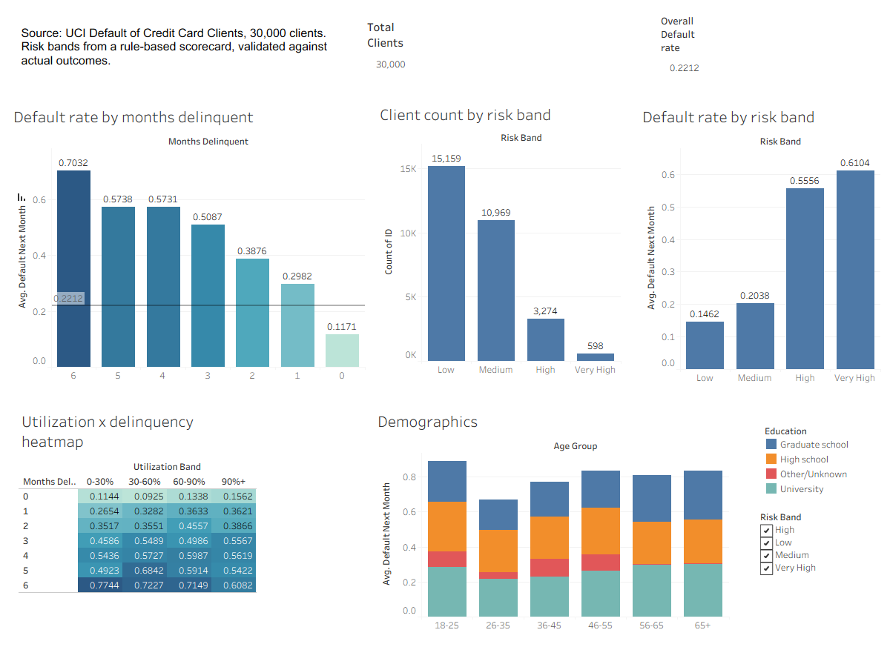
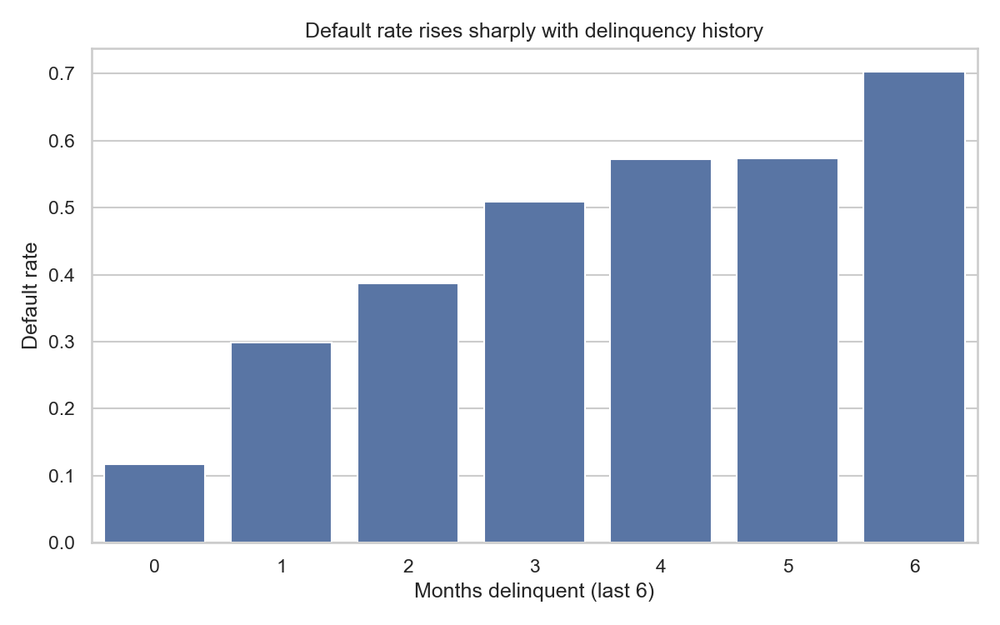

# 💳 Credit Card Default Risk Analytics

An end-to-end **data analytics** project: Python for cleaning and EDA, SQL for
the analysis layer, a transparent rule-based risk scorecard, and a Tableau
dashboard for reporting. There is **no machine learning** here: no model
training, no train/test split, no fitted classifier. Every weight and
threshold is set by hand from the EDA, which is how a risk analytics team
typically builds a first-pass scorecard before a data science team builds
anything on top of it.




## Summary

Using 30,000 credit card clients, I found that **payment history is by far the
strongest signal of default**. Clients with no late payments in the past six
months default at 11.7%, versus 70.3% for clients who were late in all six
(a 6x spread), while credit utilisation produces only a 1.8x spread. A
four-factor scorecard built from these signals separates clients into risk
bands whose actual default rates rise monotonically, with the top two bands
(13% of clients) defaulting at roughly 2.5-2.8x the baseline. It is weaker at
separating the large middle of the population, which is documented honestly
below.

## Problem Statement

Given a client's credit limit, demographics, and six months of payment
history, can an interpretable, auditable risk segmentation (without a trained
model) separate low-risk from high-risk clients in a way that matches what
actually happened?

**Success criterion:** the risk bands (Low / Medium / High / Very High) should
show a monotonically increasing actual default rate. Actual outcomes are used
**only** in a final validation step, never to build the score.

## Data

[UCI: Default of Credit Card Clients Dataset](https://archive.ics.uci.edu/dataset/350/default+of+credit+card+clients)
(also mirrored on Kaggle as `UCI_Credit_Card.csv`).

| | |
|---|---|
| Clients | 30,000 (Taiwan, 2005) |
| Overall default rate | 22.12% |
| Inputs | credit limit, sex, education, marital status, age, 6 months of repayment status, bill amounts, payment amounts |
| Outcome (validation only) | `default payment next month` (1 = defaulted) |

The raw file is not committed. See **How to Run** for where to place it.

## Approach

```
raw CSV ──► Python cleaning ──► SQLite database ──► 7 SQL queries ──┐
                                      │                             ├──► CSV reports
                                      └──► rule-based scorecard ────┤
                                                   │                │
                                    validation vs. actual outcomes  │
                                                   │                │
                                                   └──► Tableau dashboard
```

1. **Python: cleaning and feature derivation** (`src/data.py`). Undocumented
   category codes in education and marital status are collapsed into
   "Other/Unknown". Four analytical fields are derived from the raw columns:
   - `utilization`: average bill divided by credit limit
   - `months_delinquent`: how many of the last 6 months were late
   - `worst_delinquency`: the worst lateness status in that window
   - `payment_ratio`: average payment divided by average bill
2. **SQL: analysis layer** (`sql/queries.sql`, run by `src/sql_queries.py`).
   The cleaned table is loaded into a local SQLite database and seven named
   queries produce default-rate breakdowns by age, education, marital status
   and sex, credit-limit decile, delinquency count, and utilisation band. They
   use CTEs, `NTILE()` window functions, `CASE` bucketing, and `GROUP BY`, and
   are written as plain SQL that runs unchanged on Postgres or MySQL.
3. **Rule-based scorecard** (`src/risk_scorecard.py`). Four weighted factors
   combine into a 0-100 score and four bands:

   | Factor | Weight |
   |---|---|
   | Credit utilisation | 35 |
   | Months delinquent | 30 |
   | Worst delinquency | 20 |
   | Payment ratio (inverted) | 15 |

   A unit test (`test_validation_never_uses_target_to_compute_score`) proves
   that flipping every actual outcome leaves the scores unchanged, so the
   outcome column can't leak into the score.
4. **Validation.** The only place real outcomes are used: do the bands'
   actual default rates rise from Low to Very High?
5. **Reporting.** The scored dataset is exported to
   `data/processed/tableau_export.csv` and visualised in Tableau Public.

## Results

### What drives default (SQL analysis)

Baseline default rate: **22.1%**.

**Payment history: the dominant signal**



| Months late (of last 6) | Clients | Default rate |
|---|---|---|
| 0 | 19,931 | 11.7% |
| 1 | 4,426 | 29.8% |
| 2 | 1,899 | 38.8% |
| 3 | 1,154 | 50.9% |
| 4 | 951 | 57.3% |
| 5 | 298 | 57.4% |
| 6 | 1,341 | 70.3% |

| Ever 3+ months late | Clients | Default rate | Avg payment ratio |
|---|---|---|---|
| No | 28,807 | 20.4% | 0.37 |
| Yes | 1,193 | 62.9% | 0.11 |

**Credit utilisation: real but weaker**

| Utilisation band | Clients | Default rate |
|---|---|---|
| 0-30% | 15,267 | 17.9% |
| 30-60% | 5,470 | 22.0% |
| 60-90% | 6,461 | 27.7% |
| 90%+ | 2,802 | 32.6% |

**Education: a modest gap**

| Education | Clients | Default rate | Avg credit limit |
|---|---|---|---|
| High school | 4,917 | 25.2% | 126,550 |
| University | 14,030 | 23.7% | 147,062 |
| Graduate school | 10,585 | 19.2% | 212,956 |

(The 468-client "Other/Unknown" group is excluded. It comes from undocumented
category codes in the raw data and its 7.1% rate is a data artefact, not a
finding.)

### Scorecard validation

| Risk band | Clients | Actual default rate | vs. 22.1% baseline | Avg score |
|---|---|---|---|---|
| Low | 15,159 | 14.6% | 0.66x | 9.6 |
| Medium | 10,969 | 20.4% | 0.92x | 36.7 |
| High | 3,274 | 55.6% | 2.51x | 61.4 |
| Very High | 598 | 61.0% | 2.76x | 83.2 |

Default rates rise **monotonically** across the four bands, so the scorecard
passes its main validation check. The High and Very High bands together are
12.9% of clients but contain about 33% of all defaults.

## Key Findings

- **Payment history dominates every other signal.** Clients with no late
  months default at 11.7%; clients late in all six months default at 70.3%.
  Even a single late month lifts the rate to 29.8%, about 2.5x the clean
  group.
- **Severe lateness is a sharp red flag.** The 4% of clients who were ever
  3+ months late default at 62.9% versus 20.4% for everyone else, and repay
  only about 11% of their bill on average (versus 37%).
- **Utilisation matters, but much less than delinquency.** Default rises from
  17.9% to 32.6% across utilisation bands, a 1.8x spread against 6x for
  delinquency count.
- **Most defaults come from clients with clean records.** About 35% of all
  defaults come from clients with zero late months, which limits what any
  history-based rule can catch.
- **Education shows only a small gap**, and it is confounded with credit
  limit: graduate-school clients hold limits roughly 70% higher than
  high-school clients.

## Limitations & Next Steps

- **The scorecard separates the middle poorly.** The Low and Medium bands
  differ by only 6 points (14.6% vs 20.4%), and about a third of all defaults
  still fall into the Low band. There is also a sharp jump from Medium (20%)
  to High (56%) but almost none from High to Very High, which suggests the
  25/50/75 band cutoffs don't line up with where risk actually changes.
- **Weights were not tuned to the EDA.** Utilisation carries the heaviest
  weight (35) as a conventional credit-risk factor, but the EDA shows
  delinquency is the stronger signal. Re-weighting toward delinquency is a
  clear next step; doing so would mean adjusting after viewing validation
  results, which should be disclosed.
- **Associations, not causes.** Late payments and default are closely linked
  by definition, so these findings describe patterns rather than causal
  effects.
- **One snapshot.** Data is from Taiwan in 2005, so thresholds would need
  recalibrating for another population or period.
- **No new-client handling.** The scorecard assumes six months of payment
  history exist.
- **Out of scope by design:** a trained classifier (logistic regression or
  gradient boosting) would likely separate the middle bands better and would
  make a natural data-science follow-up to compare against this baseline.

## How to Run

```bash
git clone https://github.com/Anshika55861/credit-card-default-analytics.git
cd credit-card-default-analytics

python -m venv venv
source venv/bin/activate          # Windows: venv\Scripts\activate
pip install -r requirements.txt

# Download UCI_Credit_Card.csv (link in the Data section) into data/raw/

python -m src.data                # clean the raw file
python -m src.eda                 # write EDA figures to reports/figures/
python -m src.pipeline            # clean -> SQL -> scorecard -> validate -> export
pytest -q                         # run the tests
```

Run all commands from the project root with `python -m ...` so the `src`
package imports resolve.

## Tech Stack

Python (pandas, NumPy, SciPy, SQLAlchemy, matplotlib, seaborn), SQL (SQLite),
Tableau Public, pytest.

## Repo Structure

```
sql/
  schema.sql                 table definition
  queries.sql                7 named analytical queries
src/
  config.py                  paths and constants
  data.py                    load, clean, derive analytical fields
  sql_queries.py             load data into SQLite, run named queries
  risk_scorecard.py          rule-based scoring and validation (no ML)
  eda.py                     EDA figures
  pipeline.py                one-command end-to-end run
tests/
  test_data.py               cleaning logic
  test_scorecard.py          score bounds, ordering, no outcome leakage
  test_sql_queries.py        query file parsing
notebooks/
  01_full_pipeline.ipynb     interactive walkthrough
reports/
  figures/                   EDA figures and dashboard screenshot
  *.csv                      SQL query outputs and scorecard validation
data/
  raw/                       place the downloaded dataset here (not committed)
  processed/                 generated files (not committed)
```

## License

MIT. See `LICENSE`.
